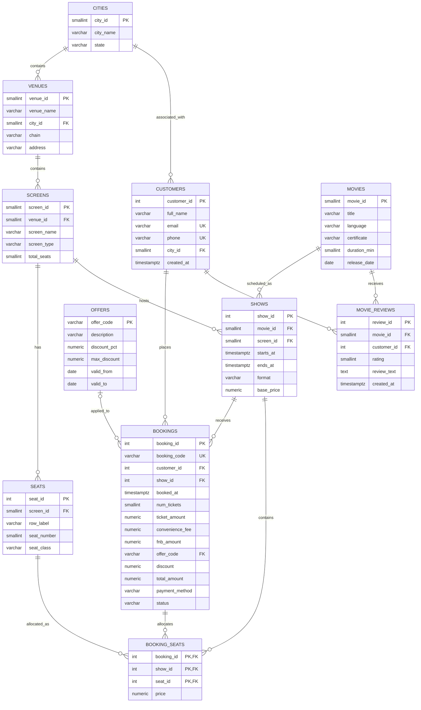

# BookMyShow Database: Schema Design

**Project:** BookMyShow Ticketing Database
**Database:** PostgreSQL 18.6
**Schema:** `bms`
**Phase:** CP1, Phase 2: Database Schema Design

---

## 1. Overview

The BookMyShow Ticketing Database models a cinema ticket booking system. It manages cities, cinema venues, screens, seats, movies, shows, customers, offers, bookings, allocated seats, and movie reviews.

The database is implemented using PostgreSQL and contains 11 relational tables.

The schema is designed to:
- Maintain referential integrity between related entities.
- Prevent duplicate seat allocations for the same show.
- Prevent overlapping shows on the same screen.
- Validate booking amounts and other business rules.
- Support reliable booking, ticket allocation, and reporting operations.

All tables are created inside the `bms` schema.

## 2. Database Tables

The database contains the following 11 tables:

| Table | Purpose |
|---|---|
| cities | Stores city and state information. |
| venues | Stores cinema venue details and their locations. |
| screens | Stores individual screens within venues. |
| seats | Stores seat positions and classes within screens. |
| movies | Stores movie information. |
| shows | Stores movie showtimes, screens, and pricing. |
| customers | Stores customer information. |
| offers | Stores promotional offer details and validity periods. |
| bookings | Stores customer booking and payment information. |
| booking_seats | Stores the seats allocated to each booking. |
| movie_reviews | Stores customer reviews and ratings for movies. |

## 3. Data Dictionary

### 3.1 cities

**Purpose:** Stores the cities in which cinema venues and customers are located.

| Column | Data type | Constraint | Description |
|---|---|---|---|
| city_id | SMALLINT | PRIMARY KEY, NOT NULL | Unique city identifier. |
| city_name | VARCHAR(30) | NOT NULL | Name of the city. |
| state | VARCHAR(30) | NOT NULL | State containing the city. |

### 3.2 venues

**Purpose:** Stores cinema venue information.

| Column | Data type | Constraint | Description |
|---|---|---|---|
| venue_id | SMALLINT | PRIMARY KEY, NOT NULL | Unique venue identifier. |
| venue_name | VARCHAR(60) | NOT NULL | Cinema venue name. |
| city_id | SMALLINT | FOREIGN KEY, NOT NULL | References cities.city_id. |
| chain | VARCHAR(30) | NOT NULL | Cinema chain name. |
| address | VARCHAR(100) | NOT NULL | Venue address. |

### 3.3 screens

**Purpose:** Stores individual cinema screens belonging to venues.

| Column | Data type | Constraint | Description |
|---|---|---|---|
| screen_id | SMALLINT | PRIMARY KEY, NOT NULL | Unique screen identifier. |
| venue_id | SMALLINT | FOREIGN KEY, NOT NULL | References venues.venue_id. |
| screen_name | VARCHAR(20) | NOT NULL | Screen name. |
| screen_type | VARCHAR(20) | NOT NULL | Screen type. |
| total_seats | SMALLINT | NOT NULL, CHECK > 0 | Declared seating capacity. |

### 3.4 seats

**Purpose:** Stores individual seats belonging to cinema screens.

| Column | Data type | Constraint | Description |
|---|---|---|---|
| seat_id | INTEGER | PRIMARY KEY, NOT NULL | Unique seat identifier. |
| screen_id | SMALLINT | FOREIGN KEY, NOT NULL | References screens.screen_id. |
| row_label | VARCHAR(5) | NOT NULL | Seat row identifier. |
| seat_number | SMALLINT | NOT NULL, CHECK > 0 | Seat number within the row. |
| seat_class | VARCHAR(20) | NOT NULL | Seat category or class. |

Additional constraint:

`UNIQUE (screen_id, row_label, seat_number)`

This prevents two seats on the same screen from having the same row and seat number.

### 3.5 movies

**Purpose:** Stores movie metadata.

| Column | Data type | Constraint | Description |
|---|---|---|---|
| movie_id | SMALLINT | PRIMARY KEY, NOT NULL | Unique movie identifier. |
| title | VARCHAR(100) | NOT NULL | Movie title. |
| language | VARCHAR(30) | NOT NULL | Movie language. |
| certificate | VARCHAR(10) | NOT NULL | Certification category. |
| duration_min | SMALLINT | NOT NULL, CHECK > 0 | Movie duration in minutes. |
| release_date | DATE | NOT NULL | Movie release date. |

### 3.6 shows

**Purpose:** Stores scheduled movie screenings.

| Column | Data type | Constraint | Description |
|---|---|---|---|
| show_id | INTEGER | PRIMARY KEY, NOT NULL | Unique show identifier. |
| movie_id | SMALLINT | FOREIGN KEY, NOT NULL | References movies.movie_id. |
| screen_id | SMALLINT | FOREIGN KEY, NOT NULL | References screens.screen_id. |
| starts_at | TIMESTAMPTZ | NOT NULL | Show start timestamp. |
| ends_at | TIMESTAMPTZ | NOT NULL | Show end timestamp. |
| format | VARCHAR(10) | NOT NULL | Screening format. |
| base_price | NUMERIC(10,2) | NOT NULL, CHECK >= 0 | Base ticket price. |

Additional constraints:

- `CHECK (ends_at > starts_at)`
- `CHECK (base_price >= 0)`
- Exclusion constraint `ex_shows_no_overlap`.

The exclusion constraint prevents two shows from overlapping on the same screen.

It uses a GiST index and `tstzrange(starts_at, ends_at, '[)')`. The half-open interval allows one show to begin exactly when the previous show ends.

The `btree_gist` PostgreSQL extension is required for this constraint.

### 3.7 customers

**Purpose:** Stores customer account information.

| Column | Data type | Constraint | Description |
|---|---|---|---|
| customer_id | INTEGER | PRIMARY KEY, NOT NULL | Unique customer identifier. |
| full_name | VARCHAR(100) | NOT NULL | Customer's full name. |
| email | VARCHAR(100) | UNIQUE, NOT NULL | Customer email address. |
| phone | VARCHAR(15) | UNIQUE, NOT NULL | Customer phone number. |
| city_id | SMALLINT | FOREIGN KEY, NOT NULL | References cities.city_id. |
| created_at | TIMESTAMPTZ | NOT NULL | Customer registration timestamp. |

Email and phone are unique to prevent duplicate customer contact records.

### 3.8 offers

**Purpose:** Stores promotional offers and their validity periods.

| Column | Data type | Constraint | Description |
|---|---|---|---|
| offer_code | VARCHAR(20) | PRIMARY KEY, NOT NULL | Unique offer identifier. |
| description | VARCHAR(100) | NOT NULL | Offer description. |
| discount_pct | NUMERIC(5,2) | NOT NULL, CHECK 0–100 | Percentage discount. |
| max_discount | NUMERIC(10,2) | NOT NULL, CHECK >= 0 | Maximum discount amount. |
| valid_from | DATE | NOT NULL | Offer starting date. |
| valid_to | DATE | NOT NULL | Offer ending date. |

Additional constraint:

`CHECK (valid_to >= valid_from)`

This ensures the offer's end date is not earlier than its start date.

### 3.9 bookings

**Purpose:** Stores customer booking, payment, pricing, and status information.

| Column | Data type | Constraint | Description |
|---|---|---|---|
| booking_id | INTEGER | PRIMARY KEY, NOT NULL | Unique booking identifier. |
| booking_code | VARCHAR(20) | UNIQUE, NOT NULL | Unique customer-facing booking code. |
| customer_id | INTEGER | FOREIGN KEY, NOT NULL | References customers.customer_id. |
| show_id | INTEGER | FOREIGN KEY, NOT NULL | References shows.show_id. |
| booked_at | TIMESTAMPTZ | NOT NULL | Booking timestamp. |
| num_tickets | SMALLINT | NOT NULL, CHECK > 0 | Number of tickets booked. |
| ticket_amount | NUMERIC(10,2) | NOT NULL, CHECK >= 0 | Total ticket amount. |
| convenience_fee | NUMERIC(10,2) | NOT NULL, CHECK >= 0 | Convenience fee. |
| fnb_amount | NUMERIC(10,2) | NOT NULL, CHECK >= 0 | Food and beverage amount. |
| offer_code | VARCHAR(20) | FOREIGN KEY, NULL allowed | Applied offer, if any. |
| discount | NUMERIC(10,2) | NOT NULL, CHECK >= 0 | Discount applied. |
| total_amount | NUMERIC(10,2) | NOT NULL, CHECK >= 0 | Final payable amount. |
| payment_method | VARCHAR(20) | NOT NULL | Payment method. |
| status | VARCHAR(20) | NOT NULL | Booking status. |

Additional constraints:

- `UNIQUE (booking_id, show_id)` supports the composite foreign key in booking_seats.
- Discount cannot exceed the sum of ticket amount, convenience fee, and F&B amount.
- Total amount must equal ticket amount plus convenience fee plus F&B amount minus discount.

The `offer_code` column is nullable because a booking does not necessarily use a promotional offer.

### 3.10 booking_seats

**Purpose:** Stores the seats allocated to individual bookings.

| Column | Data type | Constraint | Description |
|---|---|---|---|
| booking_id | INTEGER | FOREIGN KEY, NOT NULL | References bookings.booking_id. |
| show_id | INTEGER | FOREIGN KEY, NOT NULL | References shows.show_id. |
| seat_id | INTEGER | FOREIGN KEY, NOT NULL | References seats.seat_id. |
| price | NUMERIC(10,2) | NOT NULL, CHECK >= 0 | Price of the allocated seat. |

Primary key:

`PRIMARY KEY (show_id, seat_id)`

Additional unique constraint:

`UNIQUE (booking_id, seat_id)`

Composite foreign key:

`FOREIGN KEY (booking_id, show_id) REFERENCES bookings(booking_id, show_id)`

The primary key prevents the same seat from being allocated more than once for a particular show.

The composite foreign key ensures that the booking and show referenced by an allocation belong together.

### 3.11 movie_reviews

**Purpose:** Stores movie ratings and customer reviews.

| Column | Data type | Constraint | Description |
|---|---|---|---|
| review_id | INTEGER | PRIMARY KEY, NOT NULL | Unique review identifier. |
| movie_id | SMALLINT | FOREIGN KEY, NOT NULL | References movies.movie_id. |
| customer_id | INTEGER | FOREIGN KEY, NOT NULL | References customers.customer_id. |
| rating | SMALLINT | NOT NULL, CHECK 1–10 | Customer rating. |
| review_text | TEXT | NULL allowed | Optional written review. |
| created_at | TIMESTAMPTZ | NOT NULL | Review creation timestamp. |

The review text is nullable because a customer may submit a rating without writing a comment.

---

## 4. Keys and Referential Integrity

### 4.1 Primary Keys

Each of the 11 tables has a primary key.

| Table | Primary key |
|---|---|
| cities | city_id |
| venues | venue_id |
| screens | screen_id |
| seats | seat_id |
| movies | movie_id |
| shows | show_id |
| customers | customer_id |
| offers | offer_code |
| bookings | booking_id |
| booking_seats | (show_id, seat_id) |
| movie_reviews | review_id |

### 4.2 Additional UNIQUE Constraints

| Table | Unique columns |
|---|---|
| seats | (screen_id, row_label, seat_number) |
| customers | email |
| customers | phone |
| bookings | booking_code |
| bookings | (booking_id, show_id) |
| booking_seats | (booking_id, seat_id) |

### 4.3 Foreign Keys

| Child table | Foreign key | Parent table |
|---|---|---|
| venues | city_id | cities |
| screens | venue_id | venues |
| seats | screen_id | screens |
| shows | movie_id | movies |
| shows | screen_id | screens |
| customers | city_id | cities |
| bookings | customer_id | customers |
| bookings | show_id | shows |
| bookings | offer_code | offers |
| booking_seats | (booking_id, show_id) | bookings |
| booking_seats | show_id | shows |
| booking_seats | seat_id | seats |
| movie_reviews | movie_id | movies |
| movie_reviews | customer_id | customers |

There are 14 foreign-key constraints, including one composite foreign key.

### 4.4 Delete Rules

All foreign-key relationships use `ON DELETE RESTRICT`.

This prevents deleting a referenced city, venue, screen, seat, movie, show, customer, or offer while dependent records exist.

This approach protects historical booking and review records from accidental deletion.

---

## 5. Relationship Cardinalities

| Relationship | Cardinality |
|---|---|
| cities to venues | 1:N |
| cities to customers | 1:N |
| venues to screens | 1:N |
| screens to seats | 1:N |
| screens to shows | 1:N |
| movies to shows | 1:N |
| customers to bookings | 1:N |
| shows to bookings | 1:N |
| bookings to booking_seats | 1:N |
| shows to booking_seats | 1:N |
| seats to booking_seats | 1:N |
| offers to bookings | Offer to bookings: 0..N; booking to offer: 0..1 (nullable) |
| movies to movie_reviews | 1:N |
| customers to movie_reviews | 1:N |

A booking can contain multiple seats, while a seat can be allocated to different shows at different times.

The booking_seats table represents the allocation relationship between bookings, shows, and seats.

---

## 6. Entity Relationship Diagram

The following Mermaid ER diagram represents the implemented relational schema.

The composite key of booking_seats is `(show_id, seat_id)`. Its composite foreign key `(booking_id, show_id)` references bookings.

---

## 7. Functional Dependencies and Normalization

Functional dependencies describe how one set of attributes determines another set of attributes.

### 7.1 Functional Dependencies

| Table | Main functional dependency |
|---|---|
| cities | city_id → city_name, state |
| venues | venue_id → venue_name, city_id, chain, address |
| screens | screen_id → venue_id, screen_name, screen_type, total_seats |
| seats | seat_id → screen_id, row_label, seat_number, seat_class |
| seats | (screen_id, row_label, seat_number) → seat_id, seat_class |
| movies | movie_id → title, language, certificate, duration_min, release_date |
| shows | show_id → movie_id, screen_id, starts_at, ends_at, format, base_price |
| customers | customer_id → full_name, email, phone, city_id, created_at |
| customers | email → customer_id, full_name, phone, city_id, created_at |
| customers | phone → customer_id, full_name, email, city_id, created_at |
| offers | offer_code → description, discount_pct, max_discount, valid_from, valid_to |
| bookings | booking_id → all other booking attributes |
| bookings | booking_code → all other booking attributes |
| booking_seats | (show_id, seat_id) → booking_id, price |
| booking_seats | (booking_id, seat_id) → show_id, price |
| booking_seats | booking_id → show_id |
| movie_reviews | review_id → movie_id, customer_id, rating, review_text, created_at |

For movie_reviews, the current schema does not enforce uniqueness on `(customer_id, movie_id)`. Multiple reviews by one customer for the same movie are therefore possible.

### 7.2 Normalization Analysis

The schema is designed to minimize redundancy and maintain relational integrity.

Most tables satisfy BCNF because their non-trivial functional dependencies have candidate keys as determinants.

The booking_seats relation has a special case:

- Candidate key 1: `(show_id, seat_id)`
- Candidate key 2: `(booking_id, seat_id)`
- Functional dependency: `booking_id → show_id`

The dependency `booking_id → show_id` is supported by the unique booking identifier and the composite foreign key to bookings.

Because `booking_id` is not a superkey of booking_seats, this relation does not satisfy BCNF.

However, `show_id` is a prime attribute because it belongs to a candidate key. Therefore, the relation satisfies 3NF.

The composite structure is retained because it ensures that an allocated seat belongs to the same show as its booking.

### 7.3 Derived and Redundant Attributes

Some attributes could theoretically be calculated from other records.

**screens.total_seats**

This value could be calculated by counting the seats associated with a screen. It is retained as declared capacity information and for convenient capacity checks.

**bookings.ticket_amount**

This amount is related to the prices of the allocated seats. It is retained as a booking-level financial snapshot.

**booking_seats.show_id**

The show is already associated with a booking through bookings.show_id. It is retained to support the composite foreign key and enforce booking-show consistency.

**shows.ends_at**

The end timestamp could potentially be calculated using the movie duration and show start time. It is retained because the actual scheduled end time is explicitly stored and used by the show-overlap exclusion constraint.

---

## 8. Integrity Constraints

### 8.1 Constraint Summary

The implemented schema contains:

| Constraint category | Count |
|---|---:|
| Primary keys | 11 |
| Foreign keys | 14 |
| Additional UNIQUE constraints | 6 |
| CHECK constraints | 18 |
| Exclusion constraints | 1 |

PostgreSQL automatically creates indexes for primary-key and unique constraints. The exclusion constraint also creates its required GiST index.

No additional performance-tuning indexes or custom triggers are created in this phase.

### 8.2 Important Business Rules

The schema enforces the following rules:

1. Every venue must reference an existing city.
2. Every screen must belong to an existing venue.
3. Every seat must belong to an existing screen.
4. Every show must reference an existing movie and screen.
5. Show end time must be later than start time.
6. Show base price cannot be negative.
7. Two shows on the same screen cannot overlap.
8. Every customer must reference an existing city.
9. Customer email and phone must be unique.
10. Every booking must reference an existing customer and show.
11. Booking codes must be unique.
12. Ticket count must be greater than zero.
13. Monetary amounts cannot be negative.
14. Discount cannot exceed the total booking components.
15. Total amount must match the booking amount calculation.
16. Offer discount percentage must be between 0 and 100.
17. Offer end date must not precede its start date.
18. Movie review ratings must be between 1 and 10.
19. A seat cannot be allocated twice for the same show.

The rules above are enforced through primary keys, foreign keys, unique constraints, CHECK constraints, and the exclusion constraint, as appropriate.

Seat-screen consistency, screen capacity, booking allocation counts, and offer validity across different tables are additionally verified using SQL integrity checks.

---

## 9. Data Loading and Validation

The database was populated using `sql/02_load_data.sql`.

All 11 CSV files were loaded using PostgreSQL `\copy` commands in parent-before-child order.

### 9.1 Verified Row Counts

| Table | Expected records | Loaded records |
|---|---:|---:|
| cities | 10 | 10 |
| venues | 140 | 140 |
| screens | 490 | 490 |
| seats | 94,056 | 94,056 |
| movies | 300 | 300 |
| shows | 160,034 | 160,034 |
| customers | 40,000 | 40,000 |
| offers | 25 | 25 |
| bookings | 150,094 | 150,094 |
| booking_seats | 300,389 | 300,389 |
| movie_reviews | 32,510 | 32,510 |
| **Total** | **778,048** | **778,048** |

All expected records were successfully loaded and verified.

### 9.2 Integrity Check Results

Five cross-table integrity checks were executed using `sql/03_integrity_checks.sql`.

| Check | Description | Violations | Result |
|---|---|---:|---|
| 1 | Seat belongs to the screen of its show | 0 | PASS |
| 2 | Screen capacity matches actual seat count | 0 | PASS |
| 3 | Booking allocations match status and num_tickets | 0 | PASS |
| 4 | Applied offer is valid on booking date | 0 | PASS |
| 5 | No overlapping shows on the same screen | 0 | PASS |

### 9.3 Final Validation Summary

| Metric | Result |
|---|---:|
| Total integrity checks | 5 |
| Passed checks | 5 |
| Failed checks | 0 |
| Total violations | 0 |

All five integrity checks passed successfully.

The schema also passed the previously executed seed-data, foreign-key, numeric, timestamp, uniqueness, and constraint audits.

---

### 9.4 Python CSV Validation Evidence

The original 11 CSV files were also validated using `scripts/validate_data.py`. The latest successful run generated `validation_report.json`.

| Validation | Configured / Checked | Result |
|---|---:|---:|
| CSV files | 11 | 11 loaded |
| Total dataset rows | 778,048 | PASS |
| Individual foreign keys | 13 | 0 invalid |
| Composite foreign keys | 1 | 0 invalid |
| Primary and UNIQUE checks | 17 | 0 duplicates |
| Numeric columns | 36 | 0 errors |
| Proposed VARCHAR limits | 21 | 0 errors |
| Date columns | 3 | 0 errors |
| Timestamp columns | 5 | 0 errors |

The five timestamp columns contain **542,672 values** in total: 160,034 show start timestamps, 160,034 show end timestamps, 150,094 booking timestamps, 40,000 customer creation timestamps, and 32,510 review creation timestamps. All were timezone-aware and parsed successfully.

Additional cross-table validation results:

- Missing show references in booking-seat allocations: 0.
- Missing seat references in booking-seat allocations: 0.
- Seat-screen mismatches: 0.
- Screen capacity mismatches: 0.
- Status-aware booking allocation mismatches: 0.
- Offer date-range and booking validity errors: 0.
- Negative monetary values and booking amount formula errors: 0.
- Invalid show intervals and overlapping show pairs: 0.

The validator completed with **0 errors and 0 warnings**. Its detailed machine-readable results are recorded in `validation_report.json`.

## 10. Conclusion

The BookMyShow database schema contains 11 relational tables and implements the required primary keys, foreign keys, unique constraints, CHECK constraints, and show-time exclusion constraint.

The database successfully loaded and verified all 778,048 records from the provided seed dataset.

All five cross-table integrity checks returned zero violations.

The schema provides a consistent foundation for the next project phases, including query benchmarking, performance optimization, and scalability analysis.
